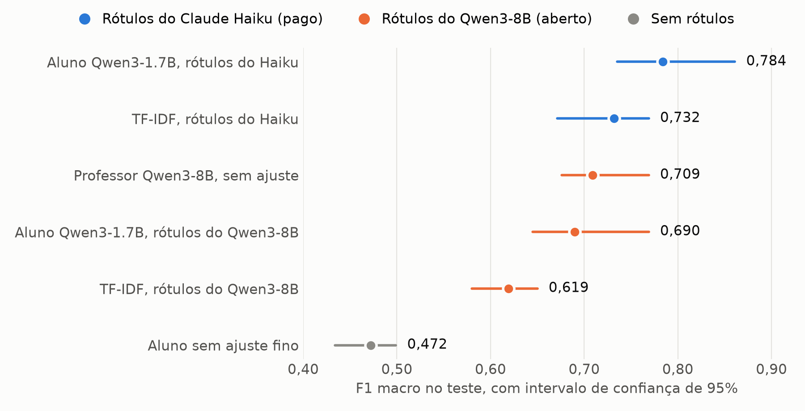

# Vale pagar uma API para rotular dados? Testei um professor aberto contra um pago

Quem trabalha com texto em português conhece o problema: a empresa tem milhares de avaliações de clientes e quer saber, para cada uma, do que a pessoa reclamou. Treinar um modelo pequeno para isso é barato. Difícil é conseguir os rótulos de treino. Hoje o atalho mais comum é pedir a um LLM grande que rotule os dados e depois ensinar um modelo menor a imitá-lo. Isso se chama destilação, e o LLM grande faz o papel de professor.

Aí aparece a dúvida que motivou este projeto: o professor precisa ser um modelo pago, rodando na nuvem, ou um modelo aberto, rodando no meu computador, resolve?

Fui medir.

## O experimento

Usei avaliações reais da Olist, um marketplace brasileiro. Para cada avaliação, o modelo responde em JSON se o cliente falou bem, mal ou de forma neutra de cinco aspectos da compra (entrega, produto, atendimento, preço e embalagem), ou se nem tocou no assunto. É o tipo de saída que um sistema de atendimento pode usar direto para decidir para onde mandar o caso.

O aluno foi sempre o mesmo: um Qwen3-1.7B ajustado com LoRA. Treinei duas cópias dele sobre as mesmas 9 mil avaliações. A única coisa que mudou foi quem escreveu os rótulos:

- **Professor pago:** Claude Haiku. Os rótulos dele já estavam prontos num conjunto público, publicado por Renato Spessotto junto com um trabalho anterior sobre os mesmos dados. Eu não paguei nada; só reaproveitei.
- **Professor aberto:** Qwen3-8B, rodando em casa pelo Ollama, numa Radeon RX 7600 de 8 GB. Ele rotulou 10 mil avaliações em cerca de 67 minutos, sem custo de API.

Os dois alunos foram avaliados no mesmo conjunto de teste, com 329 avaliações e a mesma métrica do trabalho de referência: o F1 macro de cada aspecto, com a média dos cinco. Como 329 exemplos é pouco, calculei intervalos de confiança de 95% com 1.000 reamostragens (bootstrap). Sem isso, uma diferença de dois ou três pontos pode ser só sorte.

## O resultado

O aluno treinado com os rótulos do Haiku chegou a 0,784 de F1. O treinado com os rótulos do Qwen3-8B ficou em 0,690.

Para saber se essa diferença é real, comparei os dois alunos nas mesmas reamostragens do teste. O do Haiku fica 0,091 à frente, com intervalo de +0,007 a +0,160. O intervalo não cruza o zero, então o professor pago ganhou de fato. Mas o limite de baixo passa perto do zero, o que quer dizer que a vantagem pode ser bem menor do que os 0,09 do valor central.

Outro número ajuda a dar a escala: sem nenhum ajuste fino, o mesmo Qwen3-1.7B fica em 0,472. Qualquer um dos dois professores melhora muito o aluno. O que se discute aqui é quanto a mais o professor pago entrega.

## O que mais me surpreendeu: o rótulo pesa mais que o modelo

Treinei também um classificador clássico, TF-IDF com regressão logística, uma vez com cada conjunto de rótulos. O algoritmo é idêntico nos dois casos, só muda quem rotulou. Com os rótulos do Haiku ele chega a 0,732. Com os do Qwen3-8B, 0,619.

Ou seja: um modelo simples, que roda em CPU, alimentado com rótulos melhores, empata com o próprio Qwen3-8B (0,709), que tem 8 bilhões de parâmetros. Os intervalos de confiança dos dois praticamente se sobrepõem.

Para mim, a lição é que vale gastar tempo e dinheiro na qualidade dos rótulos antes de trocar de arquitetura.

## O aluno às vezes passa o professor

Com os rótulos do Qwen3-8B, o aluno chegou a 97% do F1 do próprio professor (0,690 contra 0,709) e processa avaliações cerca de três vezes mais rápido: 6,8 por segundo, contra 2,5 do professor com quatro requisições em paralelo.

Em dois aspectos o aluno foi melhor que o professor: atendimento (0,74 contra 0,62) e produto (0,70 contra 0,65). Minha explicação é que o professor erra de um jeito pouco consistente, e o treino com 9 mil exemplos acaba suavizando esses erros. Em preço aconteceu o contrário (0,72 contra 0,98), mas só 16 avaliações do teste falam de preço, e com tão poucos casos cada erro pesa demais.

## Como coube numa placa de 8 GB

O PyTorch com ROCm 7.2 reconheceu a RX 7600 sem nenhum ajuste. O problema foi a memória: com um LoRA convencional, um lote de quatro sequências de 192 tokens já estourava os 8 GB. Três mudanças resolveram:

1. **Calcular os logits só na resposta.** O vocabulário do Qwen3 tem 151 mil tokens, então os logits da sequência inteira formam o maior tensor do treino. Passei pelo `lm_head` apenas as posições do JSON de resposta, que é onde a loss é calculada.
2. **Dar ao aluno um prompt curto.** O professor precisa do guia de anotação completo, com uns 400 tokens. O aluno, depois de treinado, já conhece o formato e recebe só uma linha, com uns 80 tokens. Essa mudança sozinha deixou o treino 3,4 vezes mais rápido, e a inferência também ficou mais barata.
3. **Arredondar o padding para múltiplos de 32.** O ROCm escolhe um kernel para cada formato de tensor. Com menos formatos diferentes, ele perde menos tempo escolhendo.

No fim, um lote de oito usa no máximo 4,3 GB, e cada aluno treina em 44 minutos. Para conferir que o resultado não dependia da minha máquina, refiz o treino do aluno do Haiku numa T4 gratuita do Kaggle: deu 0,791, praticamente o mesmo valor.

## Na prática, qual professor eu usaria?

Depende do que a empresa precisa responder.

- **Para triagem, o aberto basta.** Se a pergunta é só "esta avaliação pede uma ação da empresa?", os dois alunos encontram quase todas: 98,5% com o Haiku e 96,2% com o Qwen3-8B.
- **Em entrega, empatam.** Os dois alunos tiram 0,70. Para uma operação em que a logística é o centro do negócio, esse é o aspecto que mais importa, e nele o professor pago não trouxe vantagem.
- **Para detalhe fino, o pago rende mais.** O aluno do Haiku foi melhor em produto (0,81 contra 0,70), atendimento (0,83 contra 0,74) e preço (0,97 contra 0,72, mas com só 16 casos).
- **Se os dados não podem sair de casa, o aberto é o caminho.** Com o professor rodando localmente, nenhuma avaliação de cliente vai para uma API externa.

O próximo teste que quero fazer é misturar os dois: deixar o professor aberto rotular tudo e pagar o Haiku só nas avaliações em que o aberto parecer inseguro.

## Limitações

- O conjunto de teste foi anotado por LLMs, não por pessoas: é o consenso entre o Claude Opus e um segundo modelo. Isso pode favorecer rótulos da família Claude, como os do Haiku. Além disso, ficaram só as avaliações em que os dois concordaram, e casos de consenso costumam ser os mais fáceis.
- O teste é pequeno. Preço e embalagem aparecem em só 16 e 13 avaliações, então olhe os intervalos antes de comparar esses aspectos.
- Treinei cada aluno uma vez só, com a mesma seed. Não sei quanto o resultado varia entre execuções.
- São avaliações de e-commerce. Em outro domínio, como delivery de comida, os números podem mudar.

## Para ver e rodar

- Código, resultados e instruções: [github.com/fernandomcrsilva/review-aspects-ptbr](https://github.com/fernandomcrsilva/review-aspects-ptbr)
- O aluno dos rótulos do Qwen3-8B no Hugging Face: [FMendonca/qwen3-1.7b-aspectos-olist-qwen3-8b](https://huggingface.co/FMendonca/qwen3-1.7b-aspectos-olist-qwen3-8b). O aluno dos rótulos do Haiku não é distribuído, porque a [Política de Uso da Anthropic](https://www.anthropic.com/legal/aup) proíbe usar saídas do Claude para treinar modelos sem autorização prévia.
- Os 10 mil rótulos do Qwen3-8B: [FMendonca/olist-aspectos-silver-qwen3-8b](https://huggingface.co/datasets/FMendonca/olist-aspectos-silver-qwen3-8b)
- O treino rodando numa T4 do Kaggle: [review-aspects-ptbr-treino](https://www.kaggle.com/code/fernandomcrsilva/review-aspects-ptbr-treino)

Os dados da Olist, o conjunto de teste e os rótulos do Haiku estão sob CC BY-NC-SA 4.0. Agradeço a Renato Spessotto por publicar o conjunto e a métrica que tornaram esta comparação possível.
